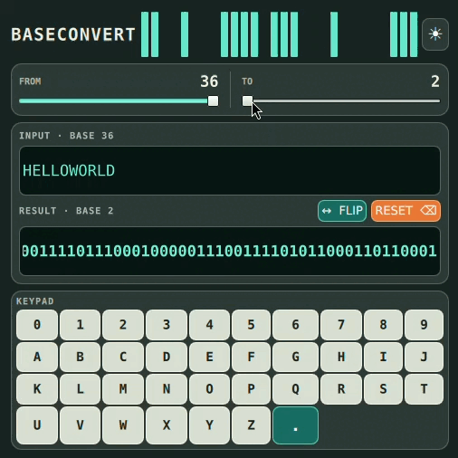

# baseconvert

Convert rational numbers between positive integer bases, with exact arithmetic and recurring fractional digits.



[PyPI](https://pypi.org/project/baseconvert/) · [Flathub](https://flathub.org/apps/io.github.breadmakesyoufull.baseconvert) · [Windows release](https://github.com/BreadMakesYouFull/baseconvert/releases/tag/windows)

## Install

Requires Python 3.10 or newer. Install the library from PyPI:

```sh
python -m pip install baseconvert
```

For the GUI, install the optional dependencies:

```sh
python -m pip install 'baseconvert[gui]'
baseconvert
```

## Run from a source checkout

Install [`just`](https://just.systems/), clone the repository, and run `just launch`. The recipe creates `.venv` and installs the GUI extra if the launcher or PySide6 QML module is missing, then starts the GUI:

```sh
git clone https://github.com/BreadMakesYouFull/baseconvert.git
cd baseconvert
just launch
```

## Development recipes

Run these from the repository root:

```sh
just install       # editable install in .venv
just install-gui   # editable install with GUI dependencies
just install-dev   # install build, Black, and Twine
just format        # format Python source
just lint          # check formatting
just test          # run doctests
just check         # lint, doctests, then check files already in dist/
just build         # clean, install development tools, build sdist and wheel
just clean         # remove build artifacts AND .venv
```

`just build` first runs `just clean`, which also deletes `.venv`, and then installs the build tools again. `just check` does not build distributions; it runs `twine check dist/*` against whatever is currently in `dist/`. `just publish-test` and `just publish` run `just check` and upload the existing `dist/*` files to TestPyPI or PyPI, respectively. To build and validate distributions before publishing, run `just build` followed by `just check` and review the files in `dist/`.

## Python library

The API accepts strings, digit tuples, integers, floats, and `fractions.Fraction` values. Use strings or `Fraction` to express exact decimal values without float representation concerns.

```python
from baseconvert import base

base("FF0.8", 16, 10, string=True)  # '4080.5'
base("4080.5", 10, 16, string=True)  # 'FF0.8'
base("-0.1", 3, 10, string=True, exact=True)  # '-0.[3]'
```

The command-line interface reads a number argument or standard input. Bases are integers; `-s` prints a string, and `--no-recurring` disables recurring notation:

```sh
python -m baseconvert -n 4080.5 -i 10 -o 16 -s
echo 0.1 | python -m baseconvert -i 3 -o 10 --no-recurring -s
```

## Digits, recurring fractions, and precision

String digits are `0123456789ABCDEFGHIJKLMNOPQRSTUVWXYZabcdefghijklmnopqrstuvwxyz`. Values above 61 use ascending Unicode characters; tuple representation is recommended for bases above 61. In a digit tuple, each digit is a base-10 integer and the radix point is `'.'`. A leading `'-'` represents a negative value.

Recurring digits are enclosed in square brackets, for example `0.[3]`. `max_depth` limits fractional digits (default 10). Set `exact=True` or `max_depth=0` to calculate the complete terminating or repeating expansion when recurring output is enabled. Exact recurring detection uses rational remainders. With recurring output disabled, an unlimited expansion is bounded by `MAX_DEPTH`.
